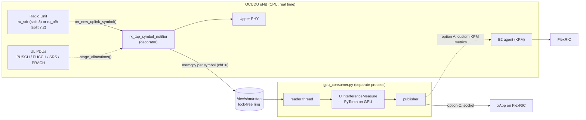

# GPU uplink interference measurement: plan

Measure uplink interference on the unscheduled resource blocks of the OCUDU gNB, compute it on the DGX Spark GPU with
PyTorch, and report a summary to FlexRIC over E2. Build and debug everything on today's 20 MHz split 8 (USRP) system,
then move to a 100 MHz O-RU system later with as little rewriting as possible.

Code that goes with this plan: [`gpu_ul_tap/`](../gpu_ul_tap/README.md).

## 1. Why this split of work

- **Today:** OCUDU gNB on the DGX Spark, split 8 over a USRP, 20 MHz. The PHY runs on the CPU (upstream OCUDU's only
  CUDA component today is the PRACH detector, see [nvidia_cuda_build.md](nvidia_cuda_build.md)). The GPU is free for our
  own processing. FlexRIC is connected over E2 and receives the standard KPM metrics.
- **Later:** 100 MHz with an O-RAN 7.2x O-RU. Lead times on O-RUs are long, so the measurement pipeline is developed
  now on the narrowband system.
- **What must carry over:** the measurement module. It takes `(grid, occupied)` tensors and returns a summary, and knows
  nothing about OCUDU, USRPs, O-RUs or Aerial. Only the adapter that produces those tensors and the publisher that
  delivers the summary are platform specific.

## 2. Architecture

Design rules:

1. **The gNB never waits for the GPU.** The ring is single producer, non-blocking. If the consumer falls behind, old
   slots are overwritten and the consumer counts them. The only cost added to the real-time path is one `memcpy` per
   port per symbol of data that is already in memory, and a few atomic stores per slot.
2. **The GPU work is a separate process.** Python, PyTorch and garbage collection stay out of the gNB process. Pin the
   consumer to cores the gNB does not use.
3. **Latency tolerant.** The near-RT RIC loop is 10 ms to 1 s, so the consumer batches slots (20 slots = 10 ms at
   30 kHz) and can take milliseconds per batch.

## 3. Phase 0: offline, no code changes

OCUDU can already dump the received resource grid to a file: see the `phy_rx_symbols_filename` and `phy_rx_symbols_port`
options in `apps/units/flexible_o_du/o_du_low/du_low_config_cli11_schema.cpp` (with optional triggers on PRACH RSSI,
PUSCH CRC failure, SINR or LDPC iterations).

1. Enable the dump for one port during a short session with the UE running iperf uplink.
2. Load the dump in Python, reshape to `[slots, symbols, subcarriers]`, and run the measurement ideas on it in NumPy or
   PyTorch on the GPU.
3. Compare against what OCUDU already reports (PUSCH SINR, noise estimates in the logs) to sanity check scaling.

This gives the students real data to work with before any C++ change.

## 4. Phase 1: live tap in the gNB

### 4.1 Where to tap

Both radio paths deliver received symbols through the same interface, `ru_uplink_plane_rx_symbol_notifier`
(`include/ocudu/ru/ru_uplink_plane.h`):

- split 8: `apps/units/flexible_o_du/split_8/helpers/ru_sdr_factories.cpp`
- split 7.2: `apps/units/flexible_o_du/split_7_2/helpers/ru_ofh_factories.cpp`

Both receive it as `flexible_o_du_ru_dependencies::symbol_notifier`
(`apps/units/flexible_o_du/split_helpers/flexible_o_du_configs.h`), which is set in
`apps/units/flexible_o_du/split_helpers/flexible_o_du_factory.cpp` to `du_impl->get_upper_ru_ul_adapter()`.

`gpu_ul_tap/rx_tap_symbol_notifier.h` is a decorator for that interface: it copies each symbol into the ring and then
forwards the call unchanged. Tapping here means the same tap keeps working when the system moves to an O-RU under OCUDU.

### 4.2 Wiring (student task)

1. Add an option (CLI/YAML, e.g. under `expert_phy`) to enable the tap and set the shared-memory name.
2. In `flexible_o_du_factory.cpp`, when enabled, construct `rx_tap_symbol_notifier` around
   `du_impl->get_upper_ru_ul_adapter()` with the cell's port count, 14 symbols, `nof_prb * 12` subcarriers and SCS, and
   pass it as `symbol_notifier`. It must outlive the radio unit, so store it in `du_impl` (or alongside the RU).
3. Add `gpu_ul_tap` to the include path for that target.
4. Run with the USRP and check the real-time counters (section 8) with the tap on and off.

The grid is stored in OCUDU as `cbf16_t` (bfloat16 I/Q, 4 bytes per RE) and `resource_grid_reader::get_view(port, l)`
gives a zero-copy view of one symbol, so the tap copies the native format and the GPU converts to complex64. At 20 MHz,
2 ports this is about 69 kB per slot; at 100 MHz, 4 ports about 0.7 MB per slot (1.4 GB/s at 30 kHz), which the Spark's
unified memory handles easily.

### 4.3 Allocation table

To measure on empty RBs, the consumer needs to know what was scheduled in every slot. Each ring slot carries a table of
up to 64 `{type, rnti, start_prb, nof_prb, start_symb, nof_symb}` entries.

- The UL PDUs for a slot reach the upper PHY before the slot is received, through `uplink_pdu_slot_repository`
  (`include/ocudu/phy/upper/uplink_pdu_slot_repository.h`: `add_pusch_pdu`, `add_pucch_pdu`, `add_srs_pdu`; PRACH
  occasions come through the PRACH path).
- Student task: at that point, convert each PDU to one or more entries (a PUSCH `rb_allocation` can be non-contiguous,
  so write one entry per contiguous run; PUCCH with frequency hopping is two entries) and call
  `rx_tap_symbol_notifier::stage_allocations(slot, entries)`.
- **Every UL channel counts as occupied, not only PUSCH.** PUCCH (usually the band edges), SRS (usually the last
  symbols), PRACH occasions and DMRS all occupy REs without a PUSCH allocation. If the table is missing for a slot, the
  consumer treats the whole slot as occupied.

## 5. Phase 2: the measurement module

`UlInterferenceMeasure` in `gpu_ul_tap/gpu_consumer.py`. Inputs: `x` complex64 `[B, P, S, K]` and `occupied` bool
`[B, S, N]`. Per batch it computes:

| Output | Meaning |
| --- | --- |
| `interf_db[P, N]` | Interference + noise power per port and PRB, averaged over free REs |
| `floor_db[P]` | Median over measurable PRBs: the noise floor estimate |
| `excess_db[N]`, `hot_prbs[N]` | How far each PRB sits above the floor; PRBs more than 3 dB above it |
| `eig_spread_db[N]` | Eigenvalue spread of the free-RE spatial covariance: high means a spatially coherent interferer rather than thermal noise |
| `free_frac[N]` | Fraction of symbols in which the PRB was measurable |

Details that matter:

- **Guard PRBs.** In-band emission and timing offsets from a UE leak into adjacent PRBs, so allocations are dilated by
  `--guard` PRBs (default 1) before choosing free REs.
- **TDD.** The radio unit only delivers the slots the upper PHY requested for uplink, so DL slots never reach the ring.
  In the special slot only the UL symbols carry data: mark the DL and guard symbols as occupied (or skip them) when
  building the occupancy mask.
- **Scaling.** Values are relative to the grid's digital scale (dBFS-like). Calibrate to dBm once with a signal
  generator, and keep calibration outside the module so it carries over to other radios.
- **Make empty RBs on purpose.** Relying on idle RBs makes measurements depend on load. OCUDU's scheduler can restrict
  PUSCH to an RB range (`pusch: start_rb / end_rb` in the cell configuration, see
  `apps/units/flexible_o_du/o_du_high/du_high/du_high_config_cli11_schema.cpp`), which leaves a known set of RBs free
  for measurement. A rotating blanked set (the uplink analogue of CSI-IM) is a later refinement in the scheduler.

Extensions once the basics work: per-UE measurements on occupied RBs using DMRS, interference time statistics
(burstiness, duty cycle), spectrogram features, or a small trained classifier for interferer type.

## 6. Phase 3: reporting to FlexRIC

The gNB-RIC interface is E2 (E1 is the CU-CP to CU-UP interface). Three options, in the order to do them:

1. **Option C, quick prototype.** The publisher sends the summary over a UDP/ZMQ socket straight to a custom xApp. Not
   O-RAN clean (the gNB is not the source), but it proves the measurements are useful before touching the E2 agent.
2. **Option A, custom KPM metrics.** Add measurements to OCUDU's KPM provider
   (`lib/e2/e2sm/e2sm_kpm/e2sm_kpm_du_meas_provider_impl.cpp`) and feed them from the consumer, e.g. through a second
   small shared-memory region written by the consumer and read by the DU. A FlexRIC KPM xApp subscribes to them by name
   like any other metric. Best for scalar per-cell or per-PRB-group values.
3. **Option B, custom service model.** If the summary is structured (per-PRB arrays, matrices), define a custom E2SM
   with matching encoders in OCUDU and FlexRIC. Most flexible, most work.

## 7. Phase 4: moving to 100 MHz and an O-RU

Two routes, and the pipeline survives both:

| | OCUDU with an O-RU (split 7.2, CPU PHY) | NVIDIA Aerial L1 (GPU PHY) |
| --- | --- | --- |
| Tap | Same `rx_tap_symbol_notifier` (it already sits on the split 7.2 path) | Aerial dApp framework: E3 interface exposes fronthaul I/Q, PUSCH DMRS channel estimates, SRS data, per-RB SNR and RB allocation; large items arrive as references into shared memory |
| Offline data | `phy_rx_symbols_*` dump | Aerial Data Lake (ClickHouse; pyAerial notebooks read it) |
| E2 | Unchanged | Depends on the L2 stack above Aerial (OAI, or OCUDU L2 over Aerial L1) |
| New code | None for the tap; check real-time headroom at 100 MHz on the Spark's 20 Arm cores | A new adapter (E3 client to tensors) and possibly a new publisher |

Upstream example configs for O-RUs under OCUDU: `configs/gnb_ru_ran550_tdd_n78_100mhz_4x2.yml` (Benetel RAN550, 100 MHz)
and `configs/gnb_ru_rpqn4800e_tdd_n78_20mhz_2x2.yml` (Foxconn RPQN-4800E).

Things to check before relying on the O-RU route:

- **Does the O-RU send unscheduled PRBs?** In 7.2x the DU's C-plane requests which PRBs and symbols the O-RU returns.
  If only scheduled PRBs are requested, there is no I/Q for the empty RBs. Check what OCUDU (and Aerial) request.
- **GPU sharing with Aerial.** With Aerial the GPU also runs the PHY with hard slot deadlines. NVIDIA isolates dApps with
  MIG on MIG-capable GPUs; whether that is available on the Spark's GB10 needs checking. Without it, keep custom work
  small and batched and watch for L1 deadline misses.
- **Shapes.** A 4T4R O-RU gives 4 ports and 273 PRBs; nothing in the module assumes 2x2.

## 8. Real-time hygiene

Check these with the tap disabled, then enabled, at the same load:

- gNB console/log: RF late, underflow and overflow counters (split 8), or OFH late/early packet counters (split 7.2).
- PUSCH CRC failures and throughput in iperf.
- Consumer counters: `overruns` (consumer too slow for the ring), `torn` (slot overwritten while copying),
  `discarded` (compute too slow; increase `--nbuf` or simplify the module).

Also: run the consumer pinned (`taskset`) on cores outside the gNB's set, raise `RLIMIT_MEMLOCK` so the ring can be
`mlock`ed, and keep the gNB's CPU governor in performance mode.

## 9. Milestones

| # | Milestone | Done when |
| --- | --- | --- |
| 1 | Synthetic pipeline | `synthetic_producer` + `gpu_consumer.py --device cuda` on the Spark finds the injected interferer |
| 2 | Offline real data | Interference per PRB computed from a `phy_rx_symbols` dump of a live session |
| 3 | Live tap | Decorator wired in, ring filled from the USRP, no change in RF late/underflow counters |
| 4 | Allocation table | Occupancy from the UL PDUs; floor estimate stable as UE load varies |
| 5 | Reserved RBs | PUSCH restricted by `start_rb/end_rb`; known free RBs measured every slot |
| 6 | RIC prototype | Summary visible in an xApp (option C) |
| 7 | KPM integration | Custom KPM metrics in OCUDU's E2 agent, read by a FlexRIC KPM xApp (option A) |
| 8 | Wideband port | Same module on 100 MHz O-RU data (OCUDU split 7.2 or Aerial) |

## 10. Open questions

- What exactly does the student's current configuration use (USRP model, ports, TDD pattern)? Set `--ports` and
  `--prb` of the synthetic producer to match.
- Which OCUDU KPM version and metric naming does FlexRIC expect? Check the "Supported E2 Metrics" page of the OCUDU
  documentation and the FlexRIC KPM xApp examples.
- For the O-RU route: which O-RU, and does its C-plane configuration return all PRBs?

## References

- OCUDU documentation: <https://docs.ocudu.org/>
- NVIDIA Aerial dApp framework: <https://docs.nvidia.com/aerial/cuda-accelerated-ran/latest/dapp_framework/index.html>
- NVIDIA Aerial Data Lake: <https://docs.nvidia.com/aerial/cuda-accelerated-ran/latest/data_lake/index.html>
- Sionna Research Kit (related OAI-based platform on DGX Spark): <https://nvlabs.github.io/sionna/rk/index.html>
