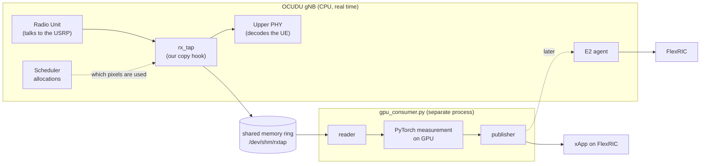

# GPU uplink interference measurement: student guide

This project measures interference on a live 5G base station, computes it on a GPU with PyTorch, and reports the result
to a network controller. No wireless background is assumed: section 2 explains everything you need, and section 7 is a
glossary to come back to.

- **Supervision:** Ruibin (PhD student) supervises day to day. Ask Ruibin first when you are stuck on the testbed.
- **Code:** repository `Ruibin2000/ocudu`. Open pull requests against **`Ruibin2000/ocudu` main**, never against the
  upstream OCUDU project.
- **Prototype code:** [`gpu_ul_tap/`](../gpu_ul_tap/README.md). Instructions for AI coding agents are in
  [`gpu_ul_tap/AGENTS.md`](../gpu_ul_tap/AGENTS.md) (see section 5).

## 1. What we are building and why

A 5G base station receives signals from phones. Sometimes it also picks up energy that nobody in the network sent:
another cell, a faulty device, a jammer. This energy is called **interference**, and it makes uplink connections slow or
unreliable. Operators want to know where it is and how strong it is.

The base station knows which parts of the spectrum it told each phone to use. Anything it receives on the parts it left
empty is interference plus background noise. Our job:

1. Copy what the base station receives, every half millisecond, out of the running software.
2. On the GPU, measure the energy on the parts nobody was scheduled to use.
3. Send a short summary ("PRBs 33 to 35 are 6 dB above the noise floor") to the network controller (FlexRIC).

The rule that shapes everything: **the base station must never wait for us.** Section 2.4 explains why.

## 2. Wireless in 15 minutes

### 2.1 The setup

| Thing | What it is in our lab |
| --- | --- |
| **gNB** (base station) | The OCUDU software, running on an NVIDIA DGX Spark (20 Arm CPU cores, a Blackwell GPU, CPU and GPU share the same memory). |
| **Radio** | A USRP: a box that turns radio waves into digital samples and back. Connected to the Spark over a network cable. |
| **UE** (user equipment) | A phone or 5G modem that connects to our gNB. |
| **Core network** | Software that authenticates the UE and routes its internet traffic. The gNB needs it to accept a UE. |
| **FlexRIC** | A controller that collects measurements from the gNB. Small programs running on it are called **xApps**. |

**Uplink (UL)** means UE to gNB. **Downlink (DL)** means gNB to UE. We only look at the uplink.

### 2.2 The received signal is an image

5G uses OFDM: it splits the spectrum into many narrow frequencies (**subcarriers**) and sends data on all of them at
once, in short time steps (**OFDM symbols**). Think of what the gNB receives as a sequence of images:

- One image per **slot** (0.5 ms in our configuration).
- Each image is 14 columns (**symbols**, time) by 612 rows (**subcarriers**, frequency).
- Each pixel is one complex number (I/Q): amplitude and phase of that frequency at that time. The pixel is called a
  **resource element (RE)**. Its power is `re² + im²`.
- Rows are grouped in blocks of 12, called **physical resource blocks (PRBs)**. 612 subcarriers = 51 PRBs. The PRB is the
  unit the scheduler hands out, so we measure per PRB.
- The gNB has 2 receive antennas (**ports**), so each slot is really a tensor `[ports=2, symbols=14, subcarriers=612]`.

That tensor is called the **resource grid**. In code it is `x[B, P, S, K]`: batch of slots, ports, symbols, subcarriers.

### 2.3 Who uses which pixels

The **scheduler** in the gNB decides, slot by slot, which PRBs and symbols each UE may transmit on. These assignments are
called **allocations**. The uplink has several kinds of transmission (**channels**), and they all occupy pixels:

| Channel | Carries | Where it usually sits |
| --- | --- | --- |
| **PUSCH** | User data (your iperf traffic) | A block of PRBs that moves from slot to slot |
| **PUCCH** | Short control messages (acks, channel quality reports) | The edges of the band |
| **SRS** | Sounding signals the gNB uses to measure the channel | The last symbols of some slots |
| **PRACH** | A phone's first "hello" when it connects | A fixed block of PRBs in specific slots |
| **DMRS** | Known pilot symbols inside PUSCH and PUCCH | Inside those allocations |

Interference + noise = power on the pixels **none** of these use. If we forget a channel (for example PUCCH), we will
mistake a phone's own signal for interference. That is the most common bug to watch for.

### 2.4 Time and why the gNB must never wait

- At our settings (30 kHz **subcarrier spacing**, SCS) a slot lasts 0.5 ms. 20 slots make a 10 ms **frame**. Frames are
  numbered by the **SFN** (system frame number, 0 to 1023, then it wraps).
- **TDD**: uplink and downlink share the same frequency and take turns in time. Only some slots are uplink, and one
  "special" slot is partly downlink, partly uplink. The gNB only gives us the uplink slots.
- The USRP streams samples continuously. If the gNB falls behind by even a fraction of a millisecond, samples are lost
  and the gNB prints **late**, **underflow** or **overflow** warnings. UEs then lose packets or disconnect.

So the code inside the gNB only copies data into shared memory and returns. All the heavy work happens in a separate
Python process that may be slow (10 ms or more is fine). If that process falls behind, it skips slots; the gNB never
notices.

### 2.5 Noise, interference and decibels

- **Noise** is the random background every receiver sees. On a quiet PRB the power is roughly constant: the **noise
  floor**.
- **Interference** shows up as PRBs whose power sits clearly above the floor.
- Powers are compared in **decibels**: `dB = 10·log10(power)`. +3 dB is twice the power, +10 dB is ten times. Our grid
  values have no physical unit, so our dB values are relative ("dBFS-like"). That is fine for finding interference.

### 2.6 How the pieces fit

**E2** is the standard interface between a gNB and a RIC controller. **KPM** is the standard set of measurements sent
over E2. In the last step our interference numbers become custom KPM measurements.

## 3. Steps and deliverables

Each step ends with something small you can **show** Ruibin and me. A step is done when its "Pass if" holds and the
deliverable is in the pull request description.

### How to hand in a step

- One pull request per step, against `Ruibin2000/ocudu` main, titled `Step N: ...`.
- In the PR description: what you changed (in your own words), the exact commands to reproduce it, and the deliverable
  (log excerpt, plot, short screen recording).
- Be ready to run it live in 5 minutes and to explain every line you changed, including lines an AI agent wrote.

### Overview

| Step | Title | Needs radio | Track |
| --- | --- | --- | --- |
| 0 | Reproduce the running gNB | yes | everyone |
| 1 | Synthetic pipeline on the GPU | no | Python |
| 2 | Look at real data offline | yes (once) | Python |
| 3 | Config option and shared-memory ring | yes for the last check | C++ |
| 4 | Live tap | yes | C++ |
| 5 | Allocation table | yes | C++ |
| 6 | Reserved PRBs | yes | C++ (config) |
| 7 | Catch a real interferer | yes | everyone |
| 8 | Summary to an xApp | no (synthetic) / yes | Python |
| 9 | Custom KPM metrics over E2 | yes | C++ |

Steps 1, 2 and 8 (Python track) can run in parallel with steps 3 to 6 (C++ track). Step 7 needs step 5.

### Step 0: Reproduce the running gNB

Ruibin already has the gNB running on the Spark with the USRP, a UE attached and FlexRIC connected. Your job is to
reproduce it yourself, from a clean checkout, without Ruibin typing anything.

1. Build OCUDU on the Spark from this repository (ask Ruibin for the CMake options in use).
2. Start the core network, the gNB with Ruibin's configuration file, and FlexRIC.
3. Attach the UE and run uplink traffic with iperf3, the UE sending to a server behind the core network (ask Ruibin
   for the exact command).
4. Write down everything you did in `gpu_ul_tap/RUNBOOK.md`: versions, commands, config files, which terminal runs
   what, and the problems you hit.

**Deliverable:** `RUNBOOK.md` + a gNB console excerpt showing the UE attached and uplink throughput.
**Pass if:** another student follows your runbook and gets the same result. Also note the late/underflow counts in the
gNB console over 5 minutes of iperf: this is the baseline for step 4.

### Step 1: Synthetic pipeline on the GPU

A fake gNB (`synthetic_producer`) writes noise, a moving PUSCH, PUCCH at the edges and an interferer on PRBs 33 to 35.
The consumer must find that interferer. Commands are in [`gpu_ul_tap/README.md`](../gpu_ul_tap/README.md).

1. Run it with `--device cpu`, then `--device cuda` on the Spark.
2. Add timing: print the compute time per batch (synchronize the GPU before reading the clock).

**Deliverable:** console output from both runs + mean and max compute time per batch.
**Pass if:** `floor_db` is near 0 on both ports, `hot_prbs=[33, 34, 35]`, `discarded=0`, and GPU time per batch is well
under 10 ms.

### Step 2: Look at real data offline

OCUDU can write the received grid to a file. Use it to see what real signals look like before changing any C++.

1. Add to the gNB config, under `log:`, `phy_rx_symbols_filename: /tmp/rx.bin`, `phy_rx_symbols_port: all` and
   `phy_rx_symbols_pusch_threshold_sinr_dB: 100`. The last option makes the gNB save every slot that has a PUSCH (it
   saves slots whose signal quality is below 100 dB, which is all of them).
2. Run 30 s of uplink iperf, then stop the gNB.
3. In a notebook: the file is raw `complex64` values, slot after slot, each slot laid out `[port][symbol][subcarrier]`.
   Reshape, compute power per PRB, and plot a **spectrogram**: PRB on the y axis, time (slot × symbol) on the x axis,
   power in dB as colour.

**Deliverable:** the spectrogram PNG and the notebook.
**Pass if:** you can point to the PUSCH blocks, the PUCCH at the band edges, and quiet PRBs at the noise floor.

### Step 3: Config option and shared-memory ring

Make the tap switchable from the gNB config and connect it inside the gNB.

1. Add two options to the gNB config (under `expert_phy`): enable the uplink grid tap, and the shared-memory name
   (default `/rxtap`). Off by default.
2. Wire the tap into the gNB so it sees every received symbol.
3. Write `gpu_ul_tap/ring_info.py`: it opens the ring and prints the header (ports, symbols, subcarriers, SCS) and how
   fast slots are arriving.

**Deliverable:** `gnb --help` output showing the options, `ring_info.py` output with the gNB running.
**Pass if:** the header matches the cell (2 ports, 14 symbols, 612 subcarriers, 30 kHz), slots arrive at the uplink rate
of your TDD pattern, and with the option off `/dev/shm/rxtap` does not exist.

### Step 4: Live tap

Run the consumer on live data and prove the gNB is not disturbed.

1. Run `gpu_consumer.py` against the live ring (the allocation table does not exist yet, so it treats every PRB as
   used; that is expected).
2. Adapt your step 2 notebook to plot a live spectrogram from the ring.
3. Run 5 minutes of uplink iperf with the tap off, then 5 minutes with the tap on.

**Deliverable:** a live spectrogram + a table: late/underflow/overflow counts, iperf throughput, consumer `overruns`,
tap off vs on.
**Pass if:** counts and throughput are the same with the tap on, and the spectrogram looks like step 2.

### Step 5: Allocation table

Tell the consumer which pixels were scheduled, for **every** uplink channel (section 2.3).

1. For each uplink slot, record the PUSCH, PUCCH, SRS and PRACH allocations and attach them to the slot in the ring.
2. Draw the allocations as boxes on top of the live spectrogram.
3. Run iperf at three loads (none, light, full) and plot `floor_db` over time.

**Deliverable:** the spectrogram with boxes + the `floor_db` plot.
**Pass if:** every bright region sits inside a box (or its 1-PRB guard), and the noise floor changes by less than 1 dB
between loads. If the floor rises with load, a channel is missing from the table.

### Step 6: Reserved PRBs

With a busy UE there may be no empty PRBs. Reserve some on purpose: restrict PUSCH to a PRB range with the `start_rb` /
`end_rb` options of the `pusch` section in the cell configuration.

**Deliverable:** the config change + a plot of `free_frac` per PRB at full load.
**Pass if:** the reserved PRBs are measurable in every uplink slot (`free_frac` close to 1) at full iperf load, and
throughput drops only by roughly the fraction of PRBs reserved.

### Step 7: Catch a real interferer

The demo that proves the whole chain works. With Ruibin, inject a known narrowband signal into the uplink band: a signal
generator or a second USRP, **connected by cable through attenuators, never over the air** unless Ruibin confirms the lab
is licensed for it.

**Deliverable:** a short screen recording: interferer off, then on, then off, with the consumer output and spectrogram.
**Pass if:** `hot_prbs` shows exactly the interferer's PRBs within one 10 ms batch of switching it on, and clears when it
is switched off, while the UE keeps running.

### Step 8: Summary to an xApp

Send the summary out of the consumer, the quick way: replace the `publish_summary` stub with a UDP or ZMQ sender, and
write a small receiver (a plain Python script first, a FlexRIC xApp if time allows).

**Deliverable:** receiver output updating live + the measured delay from slot capture (`t_ns`) to arrival.
**Pass if:** works with the synthetic producer and with the live gNB; delay well under 1 s.

### Step 9: Custom KPM metrics over E2

The proper way: the gNB reports the summary to FlexRIC itself, as custom KPM measurements, so any standard KPM xApp can
subscribe to them.

**Deliverable:** a FlexRIC KPM xApp printing the custom metric next to a standard one.
**Pass if:** the values match what the step 8 receiver shows.

## 4. Testbed rules

- Pin the consumer to CPU cores the gNB does not use (`taskset -c 16-19 ...`; ask Ruibin which cores the gNB uses).
- Before claiming a C++ change is harmless, compare the late/underflow counts with the step 0 baseline.
- Do not leave a modified gNB running on the shared testbed. Tell Ruibin when you use the radio.

## 5. Working with an AI coding agent

You are encouraged to use one. Some rules make it work well:

- `gpu_ul_tap/AGENTS.md` holds the technical instructions for agents: code locations, rules about the real-time path,
  traps already found. Most agents read `AGENTS.md` files automatically; if yours does not, tell it to read that file
  first.
- Give the agent **one step at a time**, and paste the step's deliverable and "Pass if" into your request.
- Ask it to explain wireless terms and code it touches, using the glossary below. You are responsible for every line it
  writes: if you cannot explain a change, do not submit it.
- An agent saying "it works" is not a deliverable. Run it and look at the output yourself.
- When you find a trap the agent fell into, add one line about it to `gpu_ul_tap/AGENTS.md` in the same PR.

## 6. Later: 100 MHz and a commercial radio

We plan to move to 100 MHz bandwidth with an O-RAN radio (an **O-RU**, split 7.2) and possibly NVIDIA Aerial, where the
PHY itself runs on the GPU. Grids become about 10 times larger (4 ports, 273 PRBs). The measurement code takes tensors and
knows nothing about the radio, so it carries over; keep it that way.

## 7. Glossary

| Term | Meaning |
| --- | --- |
| 5G NR | The 5G radio standard ("New Radio"). |
| gNB | 5G base station. Here: the OCUDU software. |
| CU / DU | Central unit / distributed unit: the two halves of a gNB. Our code lives in the DU. |
| UE | User equipment: a phone or modem. |
| Uplink / downlink (UL/DL) | UE to gNB / gNB to UE. |
| USRP | Software-defined radio hardware that turns radio waves into samples. |
| O-RU | Commercial O-RAN radio unit (future testbed). |
| Split 8 / split 7.2 | Where the radio stops and the gNB software starts. Split 8: the radio sends raw samples (USRP). Split 7.2: the radio does part of the processing (O-RU). |
| RU (Radio Unit, in code) | The part of OCUDU that talks to the radio hardware. |
| PHY / upper PHY | Physical layer: the signal processing that turns samples into bits. |
| OFDM | Splitting the spectrum into many narrow subcarriers sent in parallel. |
| Subcarrier | One narrow frequency. A row of the grid. |
| SCS | Subcarrier spacing. 30 kHz here. Sets the slot length (0.5 ms). |
| OFDM symbol | One time step of the grid. A column. 14 per slot. |
| RE | Resource element: one subcarrier in one symbol. A pixel. |
| PRB / RB | Physical resource block: 12 adjacent subcarriers. 51 PRBs in 20 MHz at 30 kHz. |
| Resource grid | All REs of a slot: `[ports, symbols, subcarriers]`. |
| Port | One receive antenna (2 here). |
| Slot | 14 symbols, 0.5 ms here. |
| Frame / SFN | 10 ms = 20 slots / frame counter, 0 to 1023. |
| TDD | Uplink and downlink take turns on the same frequency. |
| I/Q | The real and imaginary parts of a sample. |
| bf16 / cbf16 | bfloat16, a 16-bit float. OCUDU stores each RE as two of them (4 bytes). |
| Scheduler | Decides which UE uses which PRBs in each slot. |
| Allocation | One scheduling decision: channel, PRBs, symbols. |
| PUSCH / PUCCH / SRS / PRACH / DMRS | Uplink channels; see section 2.3. |
| FAPI | The internal message format the scheduler uses to tell the PHY what to receive. |
| Noise floor | Power of a quiet PRB: receiver noise only. |
| Interference | Unwanted energy above the noise floor. |
| dB / dBFS | Logarithmic power ratio / dB relative to the digital full scale. |
| Guard PRB | A PRB next to an allocation, skipped because a UE's signal leaks into it. |
| Eigenvalue spread | Compares the two antennas: noise looks different on each, one real interferer looks similar on both. |
| Late / underflow / overflow | gNB warnings that it missed the radio's timing. Must not increase with our tap. |
| Shared memory ring | A fixed memory buffer both processes see; the gNB writes slots in a circle, the consumer reads behind it. |
| RIC / near-RT RIC | RAN Intelligent Controller: software that monitors and steers gNBs (10 ms to 1 s loop). FlexRIC is ours. |
| xApp | A program running on the RIC. |
| E2 | Standard interface between gNB and RIC. |
| KPM | Standard set of performance measurements sent over E2. |
| iperf | Tool that generates network traffic to load the link. |

## References

- OCUDU documentation: <https://docs.ocudu.org/>
- FlexRIC: <https://gitlab.eurecom.fr/mosaic5g/flexric>
- NVIDIA Aerial dApp framework: <https://docs.nvidia.com/aerial/cuda-accelerated-ran/latest/dapp_framework/index.html>
